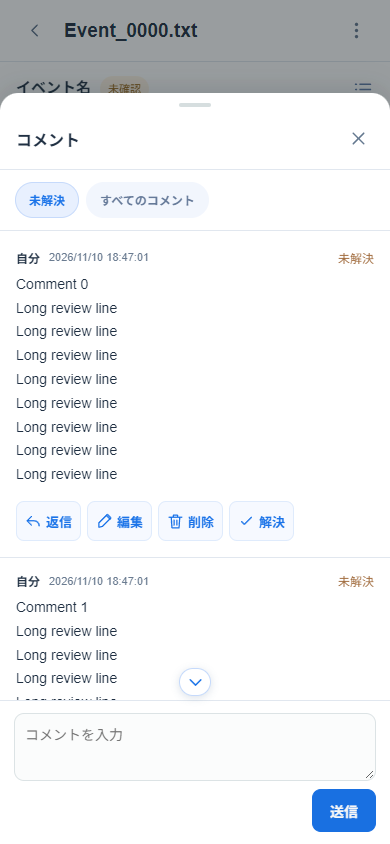

# 実装・検証結果

この文書は初期実装からの検証履歴です。以下の件数・実データ・旧機能に関する記録を、現在のテスト構成や仕様とは区別してください。現在の実行手順と保証範囲は [testing.md](testing.md)、現行の仕様は [development.md](development.md) を参照してください。

検証日：2026年11月10日（日本時間）。各フェーズのテストを通してから次へ進行。下表は初期実装時の履歴で、現在の自動補正結果は「実データ」に記載。

| フェーズ | 実装・検証                                                                        | 結果                                                                                        |
| -------- | --------------------------------------------------------------------------------- | ------------------------------------------------------------------------------------------- |
| 1        | 全日本語TXT、既存Python、モックアップの調査、Slotとレビュー単位、ID・スキーマ設計 | Python 7件成功。原文328形式、23,719 Slot、未認識0行                                         |
| 2        | UTF-8 ZIP、相対パス、構造照合、抽出、名前参照除外、コメントグループ               | Python 12件・TS 2件成功。安全に対応付けできない67ファイルを明示拒否                         |
| 3        | 単一カラムUI、自然順のフォルダ、進捗、フィルター、実コマンド・使用箇所            | TS 5件・ブラウザ2件・型チェック・本番ビルド成功。42組の色を検証                             |
| 4        | コメントと返信・編集・削除・解決・再開、承認ダイアログ、保存、復元                | TS 8件・ブラウザ4件成功。再読み込み・バックアップ復元と固定UIの位置を検証                   |
| 5        | 依頼・回答JSON、Python組み立てCLI、修正TXT、文字差分、確定・再開                  | Python 15件・TS 16件・ブラウザ6件成功。誤ったID・古い版・重複・欠落・競合の原子的拒否を検証 |
| 6        | 全実データZIP、オフラインPWA、モバイル・PC、スワイプ、キーボード、保存後の復元    | 最終チェックは下記参照                                                                      |

最終チェック：

- Python単体・実データテスト：28件成功。
- TypeScript単体テスト：50件成功。
- ブラウザテスト：78件成功（ルート38シナリオとサブパス1シナリオ×モバイル／PC）。補正した英語側の行番号でのJSON・修正TXT・確定後ZIP往復、項目検索・原文プレビュー・読み込み結果からのテキスト閲覧に加え、フォルダの三角表示、ファイル・フォルダ間移動、コメント解決後の表示維持、AI再審後の破棄とZIP往復、出力画面・指示文確認・バックアップ日時、Google Drive同期、GitHub Pages用サブパスも検証。
- TypeScript型チェック、本番ビルド、14ローカルリソースを含むPWA生成：成功。
- `git diff --check`：成功。再利用した元の翻訳スクリプトは参考版とSHA-256が一致。
- 依存追加時のnpm監査：既知の脆弱性0件（fflate 0.8.3、diff 8.0.4へ修正済み）。

環境：Windows、Node.js 26.13.0、Python 3.13.18、Pyodide 0.28.3、Playwright 1.56.1、Edge 157.0.4341.42。

## 実データ

| 種類           | 日本語の対応形式 | 読み込み成功 | ファイル単位の拒否 |
| -------------- | ---------------: | -----------: | -----------------: |
| コモンイベント |              225 |          225 |                  0 |
| データベース   |               66 |           66 |                  0 |
| マップイベント |               37 |           37 |                  0 |
| 合計           |              328 |          328 |                  0 |

- 別用途のTXT：20件をスキップ。
- 元の日本語抽出：23,719 Slot、未認識0行。
- CSV追加前の原文抽出は、対象判定後14,413 Slot。除外9,306 Slotは、未使用選択肢3,930、既定フォルダパス4、DB名前指定4,208、コモン名前指定1,164。
- 対応付け時に追加で32 Slotを除外。対応が曖昧な10箇所（2ファイル）と選択肢設定の不整合1件（CommonEvent/026.txtの数値引数2）をエラーとして報告し、他の項目は読み込み可能。
- 対応付け済みと原文未特定の英訳：15,447 Slot、14,538レビュー項目。うち14項目は原文が空で、手動補完可能。
- 複数Slotをまとめた連続コメント：478グループ。
- 複数使用箇所があるセルフ変数：2,226件。
- 原文と英訳の特殊文字列差：44 Slotを警告。入力を勝手に修正しない。
- ブラウザの全ファイル読み込み時間は `test-results/corpus-mobile.json` / `corpus-desktop.json` に出力。メインスレッドのタイマー継続も検証。

全警告・エラー、形式別集計、イベントコードの出現数、原文・英語の集約SHA-256は [validation-corpus.json](validation-corpus.json) に記録。原文・英語の集約SHA-256は初期実装時から不変。

## ブラウザで確認した操作

Edgeの390×844タッチ画面と1280×900画面で同じテストを実施。

- 実ZIP選択からフォルダ・原文・英訳・言語別の実コマンド表示。
- 項目フィルターと0件状態、カウンター、前後移動の無効化。
- フォルダ開閉で三角のSVG・パスの幅と高さが変わらないこと。
- 項目の前後移動が自然順でファイルをまたぎ、フォルダビューのフィルターで移動先を絞ること。前後両方向の確認・キャンセルと、フォルダ変更時の確認文を検証。
- 「コメントあり」で最後の未解決コメントを解決・承認しても表示を維持し、件数だけ更新すること。同じフィルターの再選択や解決済みコメントの編集でも維持し、前後移動で対象項目へ移ること。対象が残らないファイルからの移動確認も検証。
- 下部固定操作、未解決コメントの最新返信、承認ボタンの上下関係。
- コメント編集、AI返信後の編集・削除禁止、削除の確認。
- 返信・編集・削除・解決の4ボタンが1行に並び、320px幅でも折り返さず収まること。返信・編集・解決・再開後も配置と権限を維持。
- 承認時の一括解決確認、取り消しのキャンセル、確認済みフィルターから外れた項目の維持。
- IndexedDBからの再起動後の復元と、実際にダウンロードしたバックアップからの復元。
- JSONと修正TXTの往復、旧訳／新訳の文字差分、解決後の正式な新訳、再開後の旧訳と差分の復元。
- 確定した英訳TXTのZIP出力と表示用コマンドセクションの保持。
- 履歴のない連続コメントの手動分割・結合、Slot保持、再読み込み・バックアップでのグループ復元。
- オフライン再起動、コメントの永続化、キャッシュしたPyodideによるJSON出力。
- ハンドルと先頭の内容からの下スワイプ、途中スクロール時に閉じないこと。
- 左右キー移動、入力欄にキー操作が干渉しないこと。
- 全TXTの一括読み込み中も外部オリジンへの要求がないこと。
- 設定削除・英語版追加コメント・旧122引数による行ずれの自動補正。10件の曖昧な項目だけがエラーとなり、警告・対象外が別タブに分かれること。
- 原文未特定の英訳14項目の登録、周辺コマンド表示、原文補完と保存・再起動・バックアップ・再読み込みでの維持。
- 項目検索がカウンターと前後移動を変更しないこと、フォルダから項目への片方向フィルター引き継ぎ、原文1行プレビューの高さと省略。
- 読み込み結果のエラー・警告から原文・英訳のテキスト表示へ遷移し、該当行へ移動すること。大きい本文は表示行だけを描画し、読み込み拒否ファイルも再起動後に閲覧できること。
- AI採用案を解決・再開・再審し、不採用回答と元の英訳ZIPを読み込む回帰テストをモバイル／PCで追加検証。破棄のキャンセル・確定、会話履歴の保持、再開・再起動での破棄維持、ZIP再出力・再読み込みを確認。別の修正案への置換、他コメントとの競合拒否、依頼後に破棄した古い回答の拒否も単体テストで確認。
- 新しい依頼ごとに依頼・回答JSON名が変わり、出力シートの指示文が同じ依頼IDの回答名を指定すること。スクリプトのフォルダ指定を除いた約800字の指示文でも、判断形式・保留案の扱い・保持する形式を明記していること。
- 不採用案の説明と破棄ボタンの左位置が原文に揃い、新訳ボックスから12px以上離れること。原文・英訳の白背景、承認アイコンの円も確認。
- JSON・英訳TXT出力の横並び、各出力画面での全選択・解除・部分選択、対象がない場合の出力無効化。コピー後のインライン指示文を廃止し、成功・失敗の通知から中央ダイアログで全文を確認できること。Escape・Tabのフォーカス制御も検証。
- JSON名は12文字の短縮ID、JSON内部と指示文のrequestIdは完全なIDを保持。バックアップはUTC日付と異なるPacific/Honoluluで端末の現地日時をファイル名に使うことと、そのファイルからの復元を確認。
- Driveの双方向同期は実TXTから生成したレビューを使い、分離した2ブラウザ環境で検証。異なる変更の競合・採用確認・キャンセル、同期直前データのバックアップ保存、再起動時のトークン破棄と接続設定・復旧用コピーの保持を確認。
- 通信失敗からの再試行、1分ごとの自動同期、認証期限切れ、認可ポップアップのキャンセルと再接続を検証。単体テストでは同時保存による分岐、全候補の採用記録、古い選択の拒否、gzip・スキーマ・ID検証、ページ分割、401/403も確認。
- 受信を意図的に待機させた間に端末へコメントを追加し、反映を拒否して端末の編集を保持することも両画面幅で追加検証。保存直前の再検証中は操作を止め、非同期保存との間の上書きを防ぐ。
- DriveテストのGoogle認証・APIはモック。実OAuthクライアント・実Googleアカウントでの認可、実DriveのCORS・権限・保存は未検証。初期設定後の確認手順は [google-drive.md](google-drive.md) に記載。
- ルート配置の76件に加え、`BASE_PATH=/woditor-review/` の本番ビルドで専用の2件を実行。アセット・Manifest・アイコン・Service WorkerのスコープとキャッシュURL、他パスのキャッシュ保持を検証。オフラインで初めてPyodideを起動し、実TXT解析・コメント保存・レビューJSON出力・再読み込みが成功することを確認。
- `.github/workflows/deploy.yml` はmainへのpush・手動起動、Node.js 24、単体テスト・本番ビルド、Pagesへの成果物公開を定義。任意の`GOOGLE_CLIENT_ID` Secretからrunner内でだけ設定ファイルを生成する。実GitHub Actions上のデプロイ実行は未検証。

## 検証範囲

追加検証では、コメントのない項目の初回レビューJSON出力、AI指摘と未確定修正案の取り込み、任意の修正ZIPとの整合性、指摘への返信から通常の修正依頼への移行を確認。依頼対象外・古い原文・重複取り込み・保留案の競合・JSONとZIPの不一致は拒否する。

統合した読み込みは初回に原文を必須とし、以降は英訳ZIPだけでも既存の原文・コメント・未指定ファイルを保持して差分を表示する。戻る・進むによるパネル開閉、確認のキャンセル、フォルダへの復帰、ファイル境界、読み込み結果と本文、指示文プレビューも検証した。下書きは閉じる・Escape・戻るで保持し、返信・編集状態も維持する。送信成功・項目切り替えで破棄する。

通常テストでは画像を更新せず、変更のある画面を指定した場合だけ撮影する。

今回の追加検証では、保存済みセルフ変数名をIDを変えず0始まりで表示し、他の引数番号は維持することを確認。依頼モードはパネル開閉・履歴移動・再起動で保持する。出力ツリーの階層・フォルダ選択・部分選択・折りたたみ中の選択、フォルダ画面のスクロール復元、メニュー外タップ、現在の項目へのスクロールも確認した。

周辺コマンドは前後7行での表示数、全体表示での全使用箇所のマーク、0始まりの番号、言語・折り返し・開閉の再起動後の保持を検証。マウスオーバー・長押しでのツールチップと、長押し後に設定が切り替わらないことも確認。移動ボタンは幅・高さ44px、コメント48px高、承認56px高以上の実寸を確認した。

エラー・警告の項目リンクは原文未特定のSlotを含めて開き、戻る操作で結果タブを復元する。コメント入力の自動フォーカス、上端・途中・下端でのスクロール矢印、表示領域430px＋上オフセット30pxと400pxでのパネル内への収まり、検索結果1件でのページ外側スクロール禁止を検証した。ソフトキーボード自体はエミュレーションでは表示せず、VisualViewportの縮小・移動を再現している。

Windows上のEdgeで自動検証。iPhoneのSafari・Android実機でのインストールや画面下部の安全領域は、CSSとタッチ画面エミュレーションまでの検証であり、実機確認は未実施。Androidの端末戻る操作は同じブラウザ履歴操作で、太字は合成許可・700の指定を含めて検証した。Drive同期はAPIモックによる複数ブラウザ環境で確認している。

提供データの `SampleMapA/Event_0019.txt` 内3箇所、`TitleMap/Event_0000.txt` 内7箇所は日本語側の対応候補が複数ある。該当区間の英訳14項目は原文を空にしてレビュー・補完できる。手動分割・結合はコメントや変更履歴がない項目に限り、履歴の対象を勝手に移動しない。

## Python構成・選択肢検査（2026年11月12日）

共通パーサー・新規翻訳CLI・レビューCLI・アプリ用アダプターの4ファイルに分離。レビューCLIのスキーマはJSONとして内包し、参照用JSONとの一致を検証する。どちらのCLIも共通パーサーとの2ファイルだけを別ディレクトリへコピーして実行できる。

コモン・DBの入力形式、ラベルと内部値の件数・重複・有効範囲、日英の設定値の保持、通知の分類と日英それぞれの位置表示を検証。未使用設定削除は日英の582ファイルを検査し、削除可能なファイルでコマンド・CSV本文の保持と再検査の冪等性を確認した。UTF-8 BOM・CP932・CRLFの保持、元ファイルと既存ファイルの上書き拒否、不正な有効設定がある場合の出力拒否も検証。

CommonEvent/008.txtのDB参照に残る4件目以降は既知の未使用設定として補正する。CommonEvent/026.txtの数値引数2はラベル2件で、必要な0件または3件に合わず、推測で削除しない。ルール・操作方法は [python-tools.md](python-tools.md) に記載。

追加検証結果：Python 71件、TypeScript 105件、ブラウザー115件成功・1件スキップ。ブラウザーは全体実行後、分類変更に伴い警告データを差し替えた2ケースを再実行して成功。型チェック・本番ビルドも成功。スキーマ整形時は参照JSONとの同一性と単体配布の3ケースを先行確認した。スクリーンショットは更新していない。

## 英訳再読み込みの上書き（2026年11月12日）

通常の読み込みは上書き確認後に英訳を正式値として反映する。確認済み・未確認の維持、変更項目だけを未確認に戻す選択、確認前・キャンセル・端末の戻る操作で保存データが変わらないこと、再起動とZIP出力で正式値が保持されることを確認した。

変更SlotのAI保留案と旧方式の再読み込み保留差分だけを破棄し、未変更SlotのAI保留案・会話・解決状態・補完原文・手動グループを維持する。過去のAI変更は外部上書き後のコメント解決・再開で巻き戻さず、その後の新しいAI提案の解決・再開は通常どおり動作する。複数Slotの項目は1項目として集計し、対応付け失敗はファイル単位で保持する。保存形式は変更していない。

単体109件とビルドが成功。ブラウザー全体は119件成功・1件スキップ。その後、キャンセル後の承認変更と履歴からの確認復帰を検証する2ケースを追加し、関連14ケースをモバイル・PCで再実行して成功した。内容ハッシュと版の検証により古い準備結果の適用を拒否する。撮影は新しい上書き確認画面のモバイル・PCの2枚だけ。

## テスト整理（2026年11月13日）

通常テストの実データ依存を最小入力・生成データへ置き換え、重要な回帰検証を維持して重複・見た目だけの検証を整理した。判断理由と現在の構成は [testing.md](testing.md) を参照。

`.reference` を配置しない隔離コピーで、TypeScript単体107件・Python単体70件がスキップなく成功。ルート配置のPC・モバイルE2Eは108件成功、タッチ専用操作のPC側2件は対象外。Pagesサブパスの2件も、オフライン解析・保存・JSON出力まで成功した。型チェックとルート・サブパス双方の本番ビルドも成功。

E2E全体実行で見つかった表示領域変更の待機処理は修正後に両画面幅で再検証した。ブラウザー起動時に中断した2件はケースを再実行して成功。アプリ本体・保存形式・スクリーンショットは変更していない。

## 整形・lint導入（2026年11月13日）

Prettier・ESLint/typescript-eslint・Stylelint・Ruffを固定バージョンで導入し、全体の機械的整形とlint修正を別コミットに分離した。機械的整形の前後でTS/JSの文字列・テンプレートの値とPythonの構文木が一致することを確認した。Pythonの再公開importを保持し、CSSのカスケード順を変更していない。ソースのLF統一、整形・安全な修正の再実行で差分が増えないこと、整形チェック・lint（警告0）・型検査の成功を確認した。テスト登録を例外扱いした後も、コールバック内部の未処理Promise・Promiseの誤用とCSSの不明なプロパティを検出できることを確認した。

TypeScript単体107件、Python単体70件（3.13と最低対応版3.10の両方）が成功した。ルート配置のPC/モバイルE2Eは106件成功・タッチ専用のPC側2件対象外・Edge起動前の中断2件。中断した2件は個別に成功し、最終ルートビルドのPC/モバイルのオフライン動作も再確認した。Pagesサブパスの2件はオフライン解析・保存・JSON出力まで成功。ルート・サブパス双方の本番ビルドが成功し、スクリーンショットは更新していない。CIの実行結果はpush/PR後に確認する。

依存監査では開発用のESLint/typescript-eslintが使用するminimatch 10.2.6に [GHSA-g3hv-75wg-m249](https://github.com/advisories/GHSA-g3hv-75wg-m249) が報告された（moderate 10件は同一の問題と関連パッケージへの伝播）。修正版11.0.1は上流の要求範囲外のため、強制overrideは追加していない。ツール更新時の追跡事項とする。これは公開アプリに組み込まれない開発依存の監査結果で、lintの警告とは別に扱う。

## lintルールの拡張（2026年11月13日）

Ruff 0.17.5の公式デフォルトを残す `extend-select` に変更し、既存の追加ルールと合わせて438ルールを有効化した。辞書の構築順・値を保持してリテラルに置き換え、正規表現フラグの別名や未使用変数などを整理した。翻訳JSONの不正な内容に対する従来の例外型 `ValueError` は3行だけ理由付きの `TRY004` 除外で維持した。Python 3.10/3.13の各70テストが成功。

TypeScriptは候補の型付き5ルールを追加し、`checksVoidReturn` の除外を関数引数だけへ限定した。不要な型アサーションを削除し、フォーム値が文字列であることを確認する。IndexedDBの失敗では既存のエラーを保持し、エラーがnullの場合だけ説明付きのErrorを返す。`recommendedTypeChecked` 全体は追加していない。TypeScript単体107件・型検査・整形チェック・lintが成功し、整形と安全な修正の再実行で差分が増えないことも確認。違反例を使って追加5ルールとPromise検査が実際に有効であることを確認した。

ルート配置のPC/モバイルE2Eは106件成功・タッチ専用のPC側2件対象外・テスト処理前のEdge起動中断2件。中断した2件は個別再実行で成功した。PagesサブパスのPC/モバイル2件もオフライン解析・保存・JSON出力まで成功。双方の本番ビルドが成功し、スクリーンショットは更新していない。

## ZIPバックアップと分割生成（2026年11月13日）

通常・Drive同期前データのバックアップを、インデントなしUTF-8 JSONを1件入れたDEFLATEレベル6のZIPへ変更した。旧JSONも復元できる。CRC・ヘッダー・暗号化・複数JSON・展開量・参照関係を検査し、確定前・キャンセル・失敗時は現在の作業を変更しない。巨大なJSON文字列と入力モデルの複製を作らず、最大64KiBのチャンクを圧縮Workerへ1件ずつ転送する。

TypeScript単体114件、Python単体70件、整形チェック・lint（警告0）・型検査、ルート/Pagesの両ビルドが成功した。整形・安全な自動修正の再実行でファイルのハッシュが変わらないことも確認した。ルート配置のPC/モバイルE2Eは106件成功・タッチ専用のPC側2件対象外・テスト開始前のEdge起動中断2件。中断した2件は個別再実行で成功した。PagesのPC/モバイル2件も成功。通常/Drive復旧用のZIP、旧JSONの復元、確認/キャンセル/破損時の保全、端末のローカル日時、同期中の開始拒否を検証した。

大きなコメントを使い、実際のWorkerへの送信が最大64KiB・未処理1件に収まること、成功/Worker失敗時の終了、失敗したZIPをダウンロードしないこと、URLの解放をPC/モバイルで確認した。ルート/Pagesとも完全オフラインで圧縮Workerを初めて起動し、ZIPの内容を確認した。スクリーンショットは更新していない。

### メモリ比較

Windows 10.0.26300・Edge 157.0.4341.46・Node 26.13.1で、`node scripts/benchmark-backup.mjs` を実行した。160ファイル・10,240項目の日英文字列・改行・引用符・絵文字を生成し、私有データは使っていない。旧方式は変更前と同じ `JSON.stringify(state, null, 2)` を直接Blobへ渡す処理、新方式は実際の分割生成・Worker圧縮処理。方式ごとにブラウザーを新規起動し、同じページで3回実行した。

Vite開発配信でBlob・Object URLの生成までを計測し、実際のディスク保存はE2Eで別途検証する。専用ブラウザーの全プロセスをCDPから特定し、WindowsのPrivate Bytes・Working Setを集計するため、WorkerとネイティブBlobも対象になる。各回開始直前からの追加Private Bytesと全体の観測ピークを併記した。サンプリングは25msの待機＋計測・通信時間単位であり、瞬間的な最大値や他環境の数値を保証する測定ではない。

| 方式    | 回  | 出力 MiB | 生成 秒 | 追加Privateピーク MiB | 全体Privateピーク MiB | 全体Working Setピーク MiB | URL解放・GC後Private MiB |
| ------- | --- | -------- | ------- | --------------------- | --------------------- | ------------------------- | ------------------------ |
| 旧JSON  | 1   | 27.03    | 0.323   | 137.1                 | 522.4                 | 686.2                     | 262.7                    |
| 旧JSON  | 2   | 27.03    | 0.123   | 118.6                 | 381.3                 | 535.7                     | 252.7                    |
| 旧JSON  | 3   | 27.03    | 0.134   | 118.7                 | 371.4                 | 528.0                     | 251.0                    |
| 分割ZIP | 1   | 6.83     | 2.150   | 65.3                  | 434.1                 | 632.4                     | 256.3                    |
| 分割ZIP | 2   | 6.83     | 1.840   | 55.3                  | 311.6                 | 508.6                     | 248.4                    |
| 分割ZIP | 3   | 6.83     | 1.835   | 52.9                  | 301.3                 | 477.7                     | 248.8                    |

追加Privateピークの中央値は118.7→55.3MiB、出力サイズは約75%減少した。圧縮時間は増える。初回はデータ生成時の確保領域も残るため、2・3回目と開始時のメモリ量が異なる。

各回の計測後はObject URLの期限切れ（旧30秒・新1秒）とGCを待ち、全URL・Workerが0になることを確認した。メイン画面の生存ヒープは旧25.47/25.48/25.49MiB、新25.51/25.53/25.54MiBで、バックアップサイズに比例した保持の累積は見られない。新方式の最終出力からさらに30秒待機した後はPrivate 238.2MiB・Working Set 415.5MiB、旧方式は251.0MiB・408.4MiB。ブラウザーの再利用用確保領域などが残るため、Working Setが直ちに元の値へ戻るとは限らない。

生の6回分の値と30秒後の値は実行先の `.tools/quality-audit/backup-memory.json` に記録される。再計測時は既存の結果を上書きするため、比較用に残す場合は出力先を第1引数で指定する。
