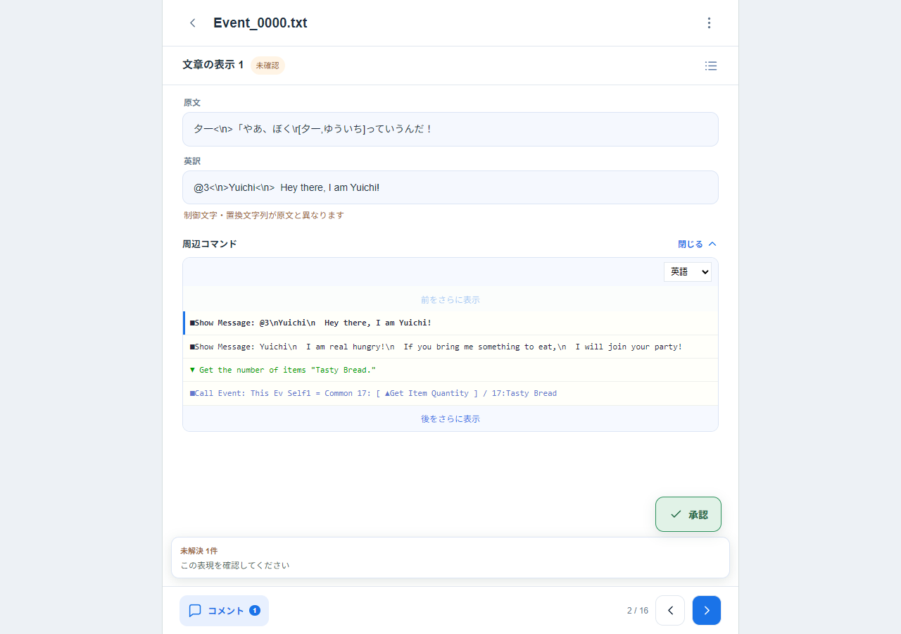
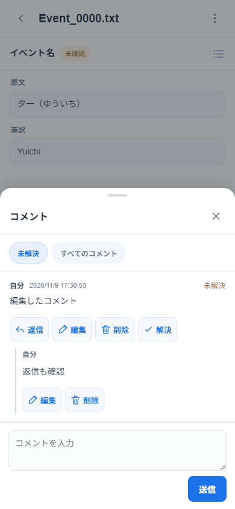
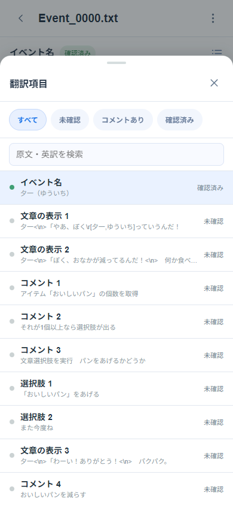
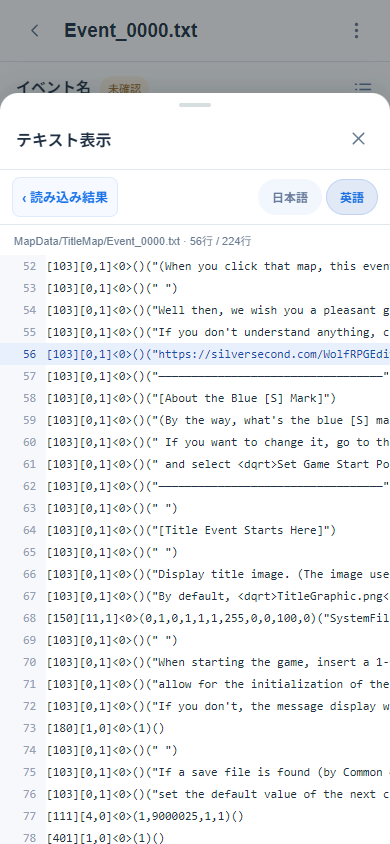
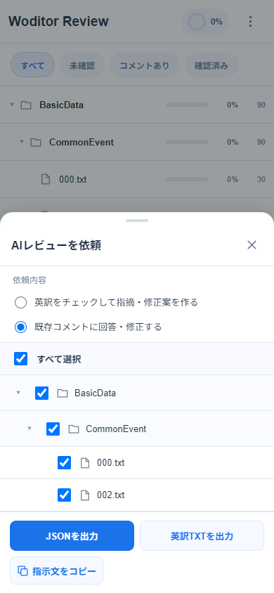
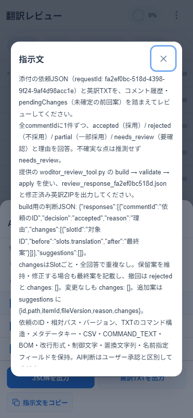
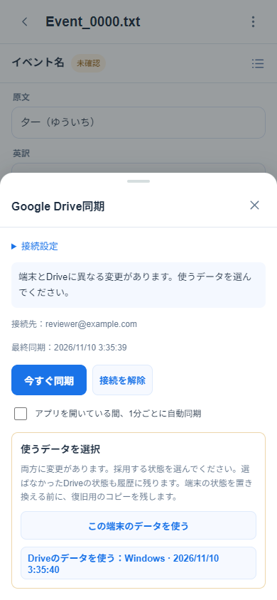

# 実装・検証結果

検証日：2026年11月10日（日本時間）。各フェーズのテストを通してから次へ進行。下表は初期実装時の履歴で、現在の自動補正結果は「実データ」に記載。

| フェーズ | 実装・検証 | 結果 |
|---|---|---|
| 1 | 全日本語TXT、既存Python、モックアップの調査、Slotとレビュー単位、ID・スキーマ設計 | Python 7件成功。原文328形式、23,719 Slot、未認識0行 |
| 2 | UTF-8 ZIP、相対パス、構造照合、抽出、名前参照除外、コメントグループ | Python 12件・TS 2件成功。安全に対応付けできない67ファイルを明示拒否 |
| 3 | 単一カラムUI、自然順のフォルダ、進捗、フィルター、実コマンド・使用箇所 | TS 5件・ブラウザ2件・型チェック・本番ビルド成功。42組の色を検証 |
| 4 | コメントと返信・編集・削除・解決・再開、承認ダイアログ、保存、復元 | TS 8件・ブラウザ4件成功。再読み込み・バックアップ復元と固定UIの位置を検証 |
| 5 | 依頼・回答JSON、Python組み立てCLI、修正TXT、文字差分、確定・再開 | Python 15件・TS 16件・ブラウザ6件成功。誤ったID・古い版・重複・欠落・競合の原子的拒否を検証 |
| 6 | 全実データZIP、オフラインPWA、モバイル・PC、スワイプ、キーボード、保存後の復元 | 最終チェックは下記参照 |

最終チェック：

- Python単体・実データテスト：25件成功。
- TypeScript単体テスト：42件成功。
- ブラウザテスト：56件成功（既存27シナリオとサブパス1シナリオ×モバイル／PC）。補正した英語側の行番号でのJSON・修正TXT・確定後ZIP往復、項目検索・原文プレビュー・読み込み結果からのテキスト閲覧に加え、フォルダの三角表示、ファイル・フォルダ間移動、コメント解決後の表示維持、AI再審後の破棄とZIP往復、出力画面・指示文確認・バックアップ日時、Google Drive同期、GitHub Pages用サブパスも検証。
- TypeScript型チェック、本番ビルド、14ローカルリソースを含むPWA生成：成功。
- `git diff --check`：成功。再利用した元の翻訳スクリプトは参考版とSHA-256が一致。
- 依存追加時のnpm監査：既知の脆弱性0件（fflate 0.8.3、diff 8.0.4へ修正済み）。

環境：Windows、Node.js 26.13.0、Python 3.13.18、Pyodide 0.28.3、Playwright 1.56.1、Edge 157.0.4341.42。

## 実データ

| 種類 | 日本語の対応形式 | 読み込み成功 | ファイル単位の拒否 |
|---|---:|---:|---:|
| コモンイベント | 225 | 225 | 0 |
| データベース | 66 | 66 | 0 |
| マップイベント | 37 | 37 | 0 |
| 合計 | 328 | 328 | 0 |

- 別用途のTXT：20件をスキップ。
- 元の日本語抽出：23,719 Slot、未認識0行。
- 名前参照等の除外後：18,347 Slot。DB名前指定4,208、コモン名前指定1,164を除外。
- 無効設定・削除コマンド等の補正により3,853 Slotを警告で除外。対応が曖昧な10 Slotをエラーで除外（2ファイル）。そのファイルの他項目は読み込み可能。
- 対応付け済みと原文未特定の英訳：14,498 Slot、13,589レビュー項目。うち14項目は原文が空で、手動補完可能。
- 複数Slotをまとめた連続コメント：478グループ。
- 複数使用箇所があるセルフ変数：2,226件。
- 原文と英訳の保護トークン差：587 Slotを警告。入力を勝手に修正しない。
- ブラウザの全ファイル読み込み時間は `test-results/corpus-mobile.json` / `corpus-desktop.json` に出力。メインスレッドのタイマー継続も検証。

全警告・エラー、形式別集計、イベントコードの出現数、原文・英語の集約SHA-256は [validation-corpus.json](validation-corpus.json) に記録。原文・英語の集約SHA-256は初期実装時から不変。

## ブラウザで確認した操作

Edgeの390×844タッチ画面と1280×900画面で同じテストを実施。

- 実ZIP選択からフォルダ・原文・英訳・言語別の実コマンド表示。
- 項目フィルターと0件状態、カウンター、前後移動の無効化。
- フォルダ開閉で三角のSVG・パスの幅と高さが変わらないこと。
- 項目の前後移動が自然順でファイルをまたぎ、フォルダビューのフィルターで移動先を絞ること。前後両方向の確認・キャンセルと、フォルダ変更時の確認文を検証。
- 「コメントあり」で最後の未解決コメントを解決・承認しても表示を維持し、件数だけ更新すること。同じフィルターの再選択や解決済みコメントの編集でも維持し、前後移動で対象項目へ移ること。対象が残らないファイルからの移動確認も検証。
- 下部固定操作、未解決コメントの最新返信、承認ボタンの上下関係。
- コメント編集、AI返信後の編集・削除禁止、削除の確認。
- 返信・編集・削除・解決の4ボタンが1行に並び、320px幅でも折り返さず収まること。返信・編集・解決・再開後も配置と権限を維持。
- 承認時の一括解決確認、取り消しのキャンセル、確認済みフィルターから外れた項目の維持。
- IndexedDBからの再起動後の復元と、実際にダウンロードしたバックアップからの復元。
- JSONと修正TXTの往復、旧訳／新訳の文字差分、解決後の正式な新訳、再開後の旧訳と差分の復元。
- 確定した英訳TXTのZIP出力と表示用コマンドセクションの保持。
- 履歴のない連続コメントの手動分割・結合、Slot保持、再読み込み・バックアップでのグループ復元。
- オフライン再起動、コメントの永続化、キャッシュしたPyodideによるJSON出力。
- ハンドルと先頭の内容からの下スワイプ、途中スクロール時に閉じないこと。
- 左右キー移動、入力欄にキー操作が干渉しないこと。
- 全TXTの一括読み込み中も外部オリジンへの要求がないこと。
- 設定削除・英語版追加コメント・旧122引数による行ずれの自動補正。10件の曖昧な項目だけがエラーとなり、警告・対象外が別タブに分かれること。
- 原文未特定の英訳14項目の登録、周辺コマンド表示、原文補完と保存・再起動・バックアップ・再読み込みでの維持。
- 項目検索がカウンターと前後移動を変更しないこと、フォルダから項目への片方向フィルター引き継ぎ、原文1行プレビューの高さと省略。
- 読み込み結果のエラー・警告から原文・英訳のテキスト表示へ遷移し、該当行へ移動すること。大きい本文は表示行だけを描画し、読み込み拒否ファイルも再起動後に閲覧できること。
- AI採用案を解決・再開・再審し、不採用回答と元の英訳ZIPを読み込む回帰テストをモバイル／PCで追加検証。破棄のキャンセル・確定、会話履歴の保持、再開・再起動での破棄維持、ZIP再出力・再読み込みを確認。別の修正案への置換、他コメントとの競合拒否、依頼後に破棄した古い回答の拒否も単体テストで確認。
- 新しい依頼ごとに依頼・回答JSON名が変わり、出力シートの指示文が同じ依頼IDの回答名を指定すること。スクリプトのフォルダ指定を除いた約800字の指示文でも、判断形式・保留案の扱い・保持する形式を明記していること。
- 不採用案の説明と破棄ボタンの左位置が原文に揃い、新訳ボックスから12px以上離れること。原文・英訳の白背景、承認アイコンの円も確認。
- JSON・英訳TXT出力の横並び、各出力画面での全選択・解除・部分選択、対象がない場合の出力無効化。コピー後のインライン指示文を廃止し、成功・失敗の通知から中央ダイアログで全文を確認できること。Escape・Tabのフォーカス制御も検証。
- JSON名は12文字の短縮ID、JSON内部と指示文のrequestIdは完全なIDを保持。バックアップはUTC日付と異なるPacific/Honoluluで端末の現地日時をファイル名に使うことと、そのファイルからの復元を確認。
- Driveの双方向同期は実TXTから生成したレビューを使い、分離した2ブラウザ環境で検証。異なる変更の競合・採用確認・キャンセル、同期直前データのバックアップ保存、再起動時のトークン破棄と接続設定・復旧用コピーの保持を確認。
- 通信失敗からの再試行、1分ごとの自動同期、認証期限切れ、認可ポップアップのキャンセルと再接続を検証。単体テストでは同時保存による分岐、全候補の採用記録、古い選択の拒否、gzip・スキーマ・ID検証、ページ分割、401/403も確認。
- 受信を意図的に待機させた間に端末へコメントを追加し、反映を拒否して端末の編集を保持することも両画面幅で追加検証。保存直前の再検証中は操作を止め、非同期保存との間の上書きを防ぐ。
- DriveテストのGoogle認証・APIはモック。実OAuthクライアント・実Googleアカウントでの認可、実DriveのCORS・権限・保存は未検証。初期設定後の確認手順は [google-drive.md](google-drive.md) に記載。
- ルート配置の既存54件に加え、`BASE_PATH=/woditor-review/` の本番ビルドで専用の2件を実行。アセット・Manifest・アイコン・Service WorkerのスコープとキャッシュURL、他パスのキャッシュ保持を検証。オフラインで初めてPyodideを起動し、実TXT解析・コメント保存・レビューJSON出力・再読み込みが成功することを確認。
- `.github/workflows/deploy.yml` はmainへのpush・手動起動、Node.js 24、単体テスト・本番ビルド、Pagesへの成果物公開を定義。任意の`GOOGLE_CLIENT_ID` Secretからrunner内でだけ設定ファイルを生成する。実GitHub Actions上のデプロイ実行は未検証。

## 検証範囲

Windows上のEdgeで自動検証。iPhoneのSafari・Android実機でのインストールや画面下部の安全領域は、CSSとタッチ画面エミュレーションまでの検証であり、実機確認は未実施。複数端末間の同期はなく、バックアップを介して移行する。

提供データの `SampleMapA/Event_0019.txt` 内3箇所、`TitleMap/Event_0000.txt` 内7箇所は日本語側の対応候補が複数ある。該当区間の英訳14項目は原文を空にしてレビュー・補完できる。手動分割・結合はコメントや変更履歴がない項目に限り、履歴の対象を勝手に移動しない。
